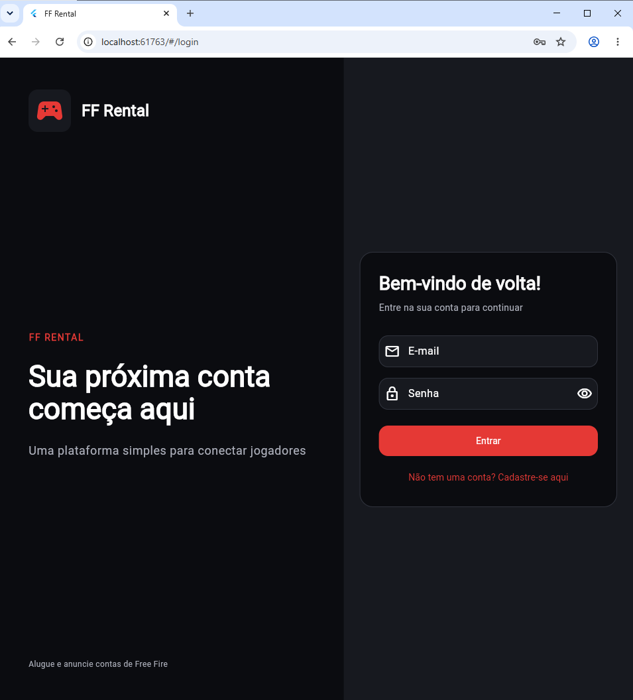
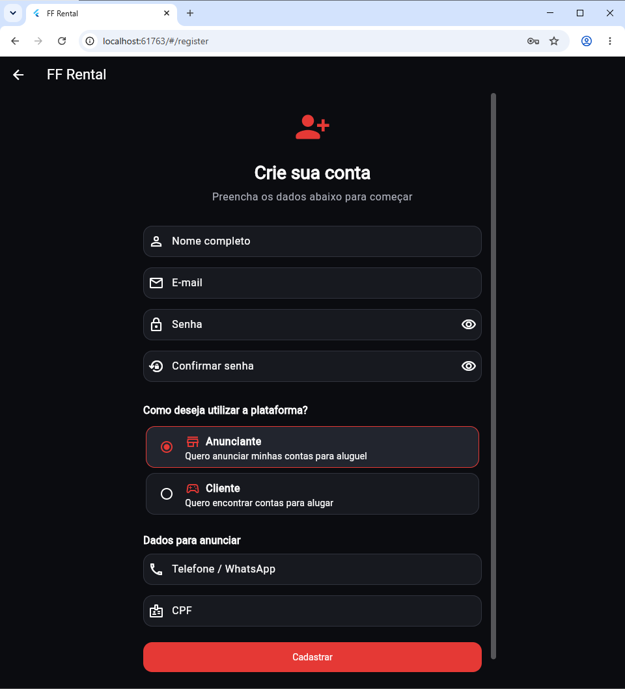
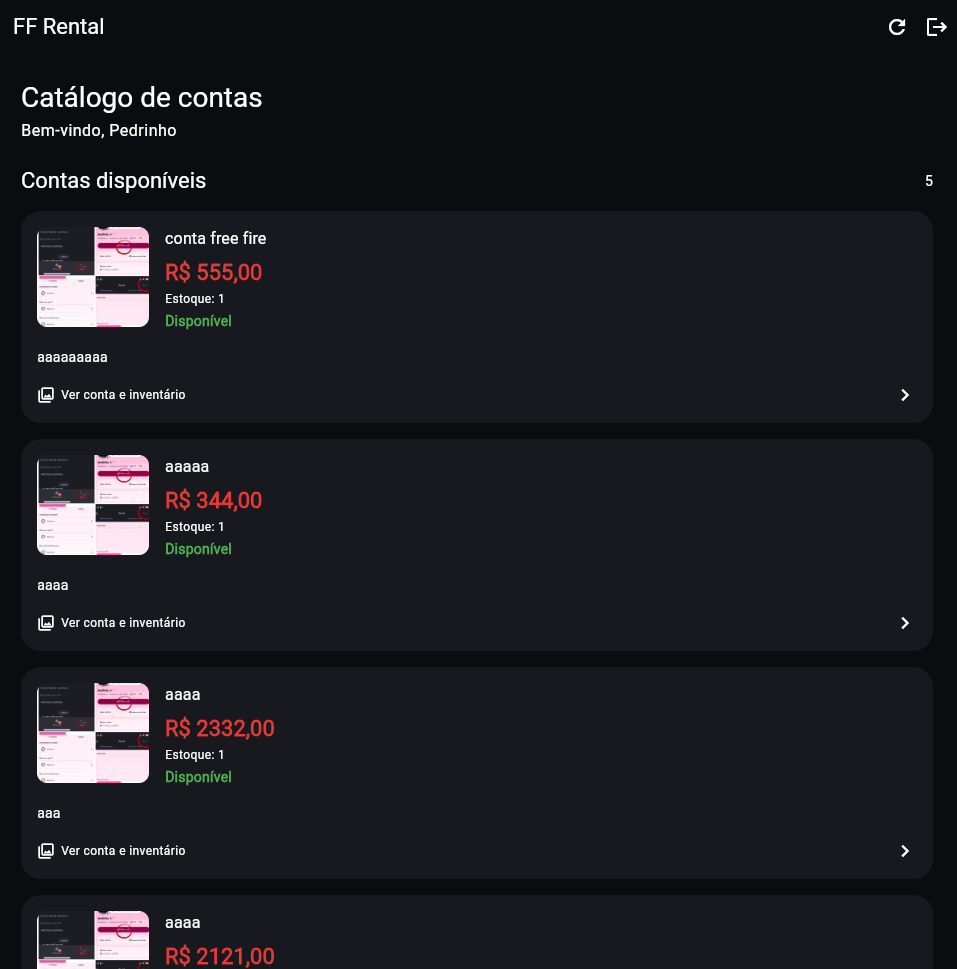
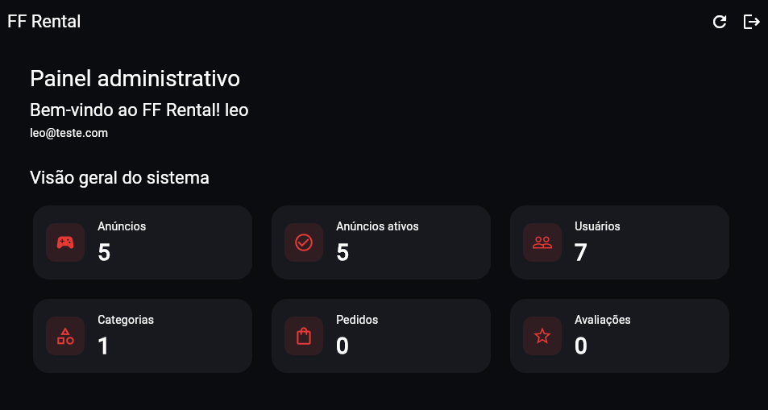
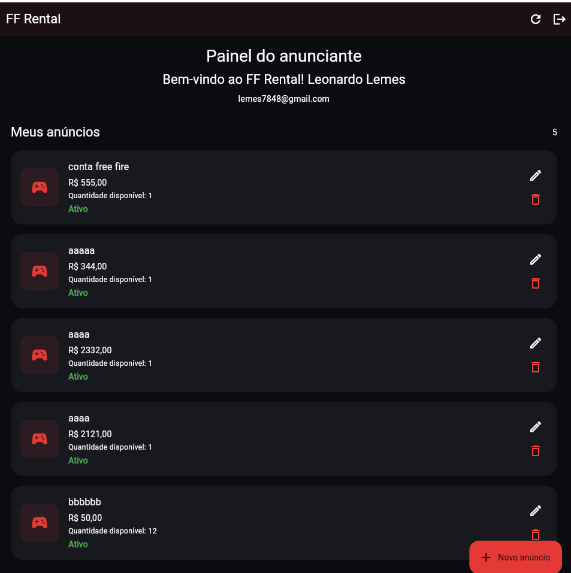
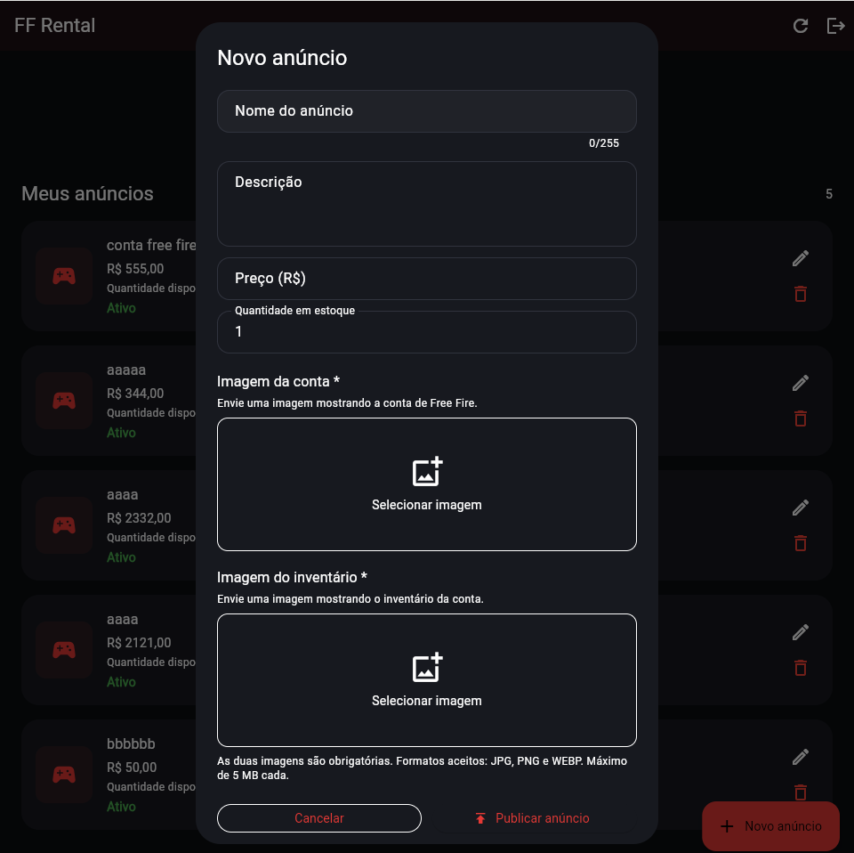

# FF Rental

**Marketplace para anúncios e aluguel de contas de Free Fire.**

## Informações do projeto

- **Aluno:** Leonardo Lemes Passos
- **Curso:** Tecnologia em Análise e Desenvolvimento de Sistemas (TADS)
- **Disciplinas:** Programação para Dispositivos Móveis, Paradigmas de Linguagem de Programação e Programação Orientada a Objetos para Web
- **Back-end:** Opção A — API Laravel
- **Front-end:** Flutter / Dart
- **Banco de dados:** MySQL

## Sobre o projeto

O FF Rental é um aplicativo desenvolvido em Flutter e integrado a uma API Laravel. Seu objetivo é permitir o cadastro, a consulta e o gerenciamento de anúncios de contas de Free Fire.

O sistema possui três perfis de usuário:

- **Administrador:** acessa o painel administrativo e consulta os indicadores do sistema.
- **Vendedor:** publica e gerencia seus próprios anúncios.
- **Comprador:** consulta os anúncios disponíveis no catálogo.

Cada anúncio deve possuir duas imagens: uma da conta e outra do inventário, para que os interessados possam visualizar as informações do anúncio.

## Funcionalidades

### Autenticação e usuários

- Cadastro e login de usuários.
- Controle de acesso por perfil.
- Persistência da sessão do usuário.

### Anúncios

- Cadastro de anúncios.
- Listagem dos próprios anúncios.
- Consulta do catálogo de anúncios ativos.
- Edição e exclusão de anúncios.
- Envio das imagens da conta e do inventário.
- Armazenamento das imagens no back-end.

### Painéis

- Painel do vendedor com gerenciamento dos próprios anúncios.
- Painel administrativo com indicadores de anúncios, usuários, categorias, pedidos e avaliações.
- Catálogo para consulta dos anúncios pelos compradores.

## Tecnologias utilizadas

### Aplicativo

- Flutter e Dart
- Dio
- GoRouter
- Flutter Secure Storage
- Image Picker

### Back-end

- PHP e Laravel
- Laravel Sanctum
- MySQL
- Docker

## Arquitetura do projeto

O aplicativo utiliza arquitetura em camadas para separar as responsabilidades e facilitar a manutenção do código.

```text
apps/ff_rental/lib/
├── main.dart
├── app.dart
├── core/
│   ├── constants/
│   ├── routes/
│   ├── theme/
│   └── utils/
├── models/
├── repositories/
├── services/
└── screens/
    ├── auth/
    └── home/
```

### Responsabilidades das camadas

- **Models:** representam as entidades e fazem a conversão dos dados JSON.
- **Repositories:** realizam as operações de comunicação com a API.
- **Services:** intermediam as operações entre as telas e os repositories.
- **Screens:** apresentam as interfaces e recebem as interações dos usuários.
- **Core:** concentra constantes, rotas, temas e utilitários.

O fluxo de comunicação segue esta estrutura:

```text
Screen
  ↓
Service
  ↓
Repository
  ↓
API Laravel
  ↓
Banco de dados MySQL
```

## Telas e rotas

| Tela | Rota / acesso |
|---|---|
| Login | `/login` |
| Cadastro | `/register` |
| Painel administrativo | `/admin` |
| Painel do vendedor | `/seller` |
| Catálogo do comprador | `/catalog` |
| Cadastro de anúncio | Formulário acessado pelo painel do vendedor |

A navegação entre as telas é realizada com GoRouter e rotas nomeadas.

## Capturas de tela

### Login


### Cadastro


### Catálogo


### Painel administrativo


### Painel do vendedor


### Cadastro de anúncio


## Como executar o projeto

### Requisitos

- Flutter SDK e Dart SDK instalados.
- Docker Desktop.
- Git.
- Google Chrome (para executar o Flutter Web).

### 1. Iniciar os serviços do back-end

Na raiz do repositório, execute:

```bash
docker compose up -d
```

Na primeira execução, instale as dependências do Composer e crie o `.env` somente se ele ainda não existir:

```bash
docker exec -it poo_web_php bash
composer install
if [ ! -f .env ]; then cp .env.example .env; fi
php artisan key:generate
exit
```

> Confira as variáveis de banco de dados no `.env` antes de executar as migrations. Não sobrescreva um `.env` já configurado e não adicione credenciais ou variáveis privadas ao GitHub.

### 2. Executar as migrations e configurar as imagens

```bash
docker exec -it poo_web_php php artisan migrate
docker exec -it poo_web_php php artisan storage:link
```

### 3. Executar o aplicativo Flutter

Entre na pasta do aplicativo:

```bash
cd apps/ff_rental
```

Instale as dependências:

```bash
flutter pub get
```

Execute no Chrome:

```bash
flutter run -d chrome
```

### 4. Endereço da API

A API local utilizada pelo aplicativo é:

```text
http://localhost:8182/api
```

A URL base é configurada em `apps/ff_rental/lib/core/constants/api_constants.dart`.

## Verificação de qualidade

Dentro de `apps/ff_rental`, os comandos de verificação são:

```bash
dart format .
flutter analyze
flutter test
```

## Considerações finais

O FF Rental foi desenvolvido como projeto acadêmico para aplicar conceitos de desenvolvimento mobile, programação orientada a objetos, integração com APIs REST e arquitetura em camadas.

O aplicativo utiliza Flutter no front-end e Laravel no back-end, com persistência dos dados em MySQL.
